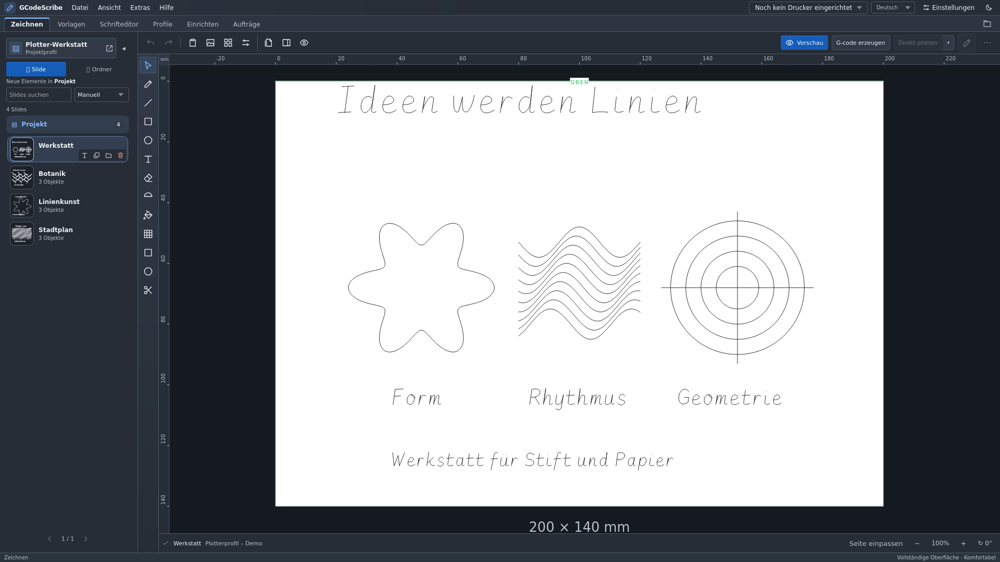
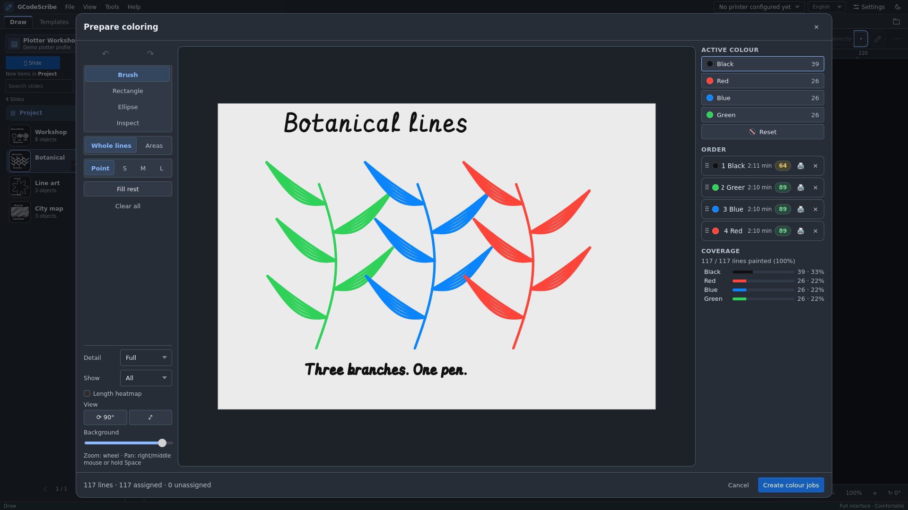
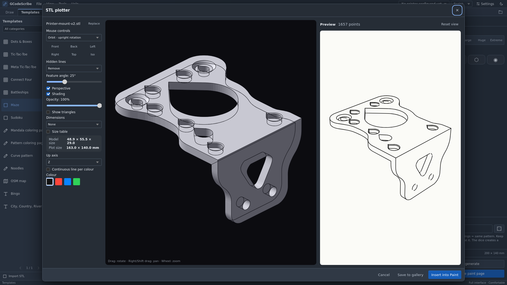
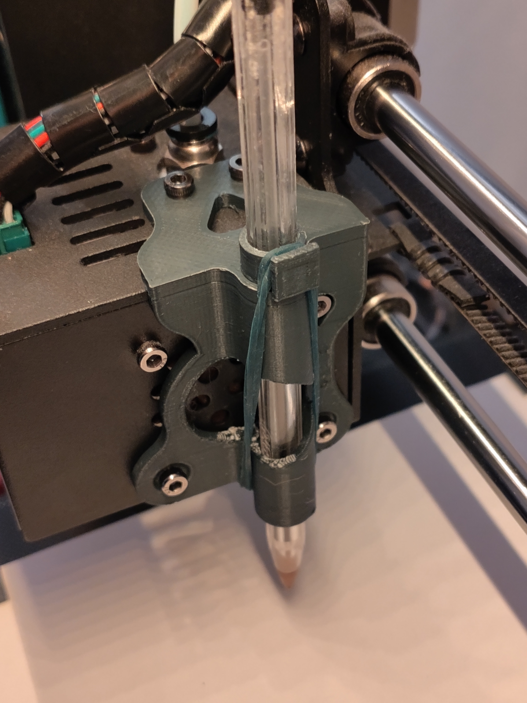

<p align="center">
  
</p>
<h1 align="center">GCodeScribe</h1>
<p align="center"><strong>Deine Ideen. Deine Handschrift. Dein Stiftplotter.</strong><br>Zeichnungen, Dokumente und eigene Schriften gestalten, kalibrieren und als G-Code aufs Papier bringen.</p>
<p align="center">
  <a href="https://github.com/Friedjof/gcodescribe/releases/latest"></a>
  <a href="https://github.com/Friedjof/gcodescribe/actions/workflows/release.yml"></a>
  
  
</p>
<p align="center"><a href="#installation">Installation</a> · <a href="#was-du-damit-machen-kannst">Funktionen</a> · <a href="#stifthalter-selbst-bauen">Druckteile &amp; Material</a> · <a href="docs/screenshots.md">Bildergalerie</a> · <a href="docs/releases/0.6.1.md">Neu in v0.6.1</a></p>

<table>
  <tr>
    <td width="50%"><a href="media/screenshots/design-overview.png"></a><br><strong>Zeichnen und gestalten</strong><br>Mehrere Objekte, eigene Schrift und ein präziser Zeichenbereich.</td>
    <td width="50%"><a href="media/screenshots/font-editor.png"></a><br><strong>Eigene Handschrift entwickeln</strong><br>Zeichen als echte Stiftbewegungen erfassen und Varianten bearbeiten.</td>
  </tr>
</table>
<table>
  <tr>
    <td width="33%"><a href="media/screenshots/color-layers.png"></a><br><strong>Farblayer vorbereiten</strong><br>Zeichnungen auf mehrere Stiftfarben verteilen.</td>
    <td width="33%"><a href="media/screenshots/stl-import.png"></a><br><strong>3D wird Linienzeichnung</strong><br>STL ausrichten, Kanten wählen und die Plot-Vorschau prüfen.</td>
    <td width="33%"><a href="media/screenshots/profile-calibration.png"></a><br><strong>Papier und Stift einrichten</strong><br>Zeichenfläche, Papier-Ecken und Stiftpositionen im Blick.</td>
  </tr>
</table>

Alle App-Aufnahmen zeigen eine getrennte Demo-Umgebung mit neutralen Inhalten. Die editierbare [Beispielschrift „Werkstatt“](media/examples/werkstatt-demo.gcsfont) kannst du selbst importieren. Weitere Ansichten findest du in der [Bildergalerie](docs/screenshots.md).

## Was du damit machen kannst

- **Gestalten:** Zeichnungen, Texte und importierte Motive auf Seiten anordnen. Projekte bündeln zusammengehörige Seiten und verwenden ihr eigenes Kalibrierungsprofil.
- **Handschrift bearbeiten:** Eigene Stiftschriften mit mehreren Zeichenvarianten erstellen, im Schreibtest ausprobieren und als `.gcsfont` importieren oder exportieren.
- **Dateien umwandeln:** SVG, Bilder, PDF, Office-Dokumente und native Xournal++-Stiftzüge übernehmen. Größere Importe laufen als Hintergrundaufträge.
- **Vorlagen verwenden:** Spiele, Labyrinthe, Sudoku, Muster, Karten und technische STL-Linienzeichnungen erzeugen.
- **Plotten vorbereiten:** Fahrwege in 3D prüfen, Papier- und Profilumrisse einblenden, Farblayer aufteilen und G-Code exportieren.
- **Mehrere Drucker verwalten:** Gespeicherte Plotter über USB/Serial oder OctoPrint auswählen und ihre Verbindungen getrennt testen.
- **Einrichten und steuern:** Papier über vier Ecken oder zwei diagonale Ecken bestimmen, Stifthöhen kalibrieren und Einsetz- sowie Parkpositionen verwenden.
- **Optional KI nutzen:** Bilder über einen OpenAI-API-Schlüssel oder einen Codex-/ChatGPT-Zugang erzeugen und verbessern. Es gelten die Limits des ausgewählten Zugangs; ein automatischer Wechsel zur API-Abrechnung findet nicht statt.
- **MCP anbinden:** Auch die laufende Desktop-App bietet einen lokalen, durch Token geschützten MCP-Zugang mit dauerhaftem Port.

## Installation

### Linux-Desktop

Lade die passende Datei von der [Release-Seite](https://github.com/Friedjof/gcodescribe/releases/latest) herunter. Für die eigenständige GTK-/WebKit-Desktop-App ist das **Flatpak** vorgesehen:

```sh
flatpak install --user ./GCodeScribe-v0.6.1.flatpak
flatpak run info.noweck.gcodescribe
```

Der erste Aufruf zeigt die Einrichtungsführung. Die App folgt auf Wunsch dem Systemtheme; der kleine Schalter oben rechts wechselt zwischen hell und dunkel. Druckerauswahl, Sprache und Einstellungen sind direkt im Header erreichbar.

### Debian, RPM und AppImage

Die Releases enthalten außerdem Pakete für die Web-Anwendung. Beispiel für Debian/Ubuntu:

```sh
sudo apt install ./gcodescribe_0.6.1_amd64.deb
gcodescribe-web
```

Öffne anschließend `http://localhost:8000`. Die Python-Anwendung benötigt Python 3.12 oder neuer. RPM und AppImage stehen beim selben Release bereit.

### Docker Compose

```sh
cp .env.example .env
docker compose up --build
```

Die Weboberfläche ist standardmäßig unter `http://localhost:8000` erreichbar. Verbindungen, optionale KI-Funktionen und den veröffentlichten Port kannst du über `.env` konfigurieren. Ein anderer Host-Port wird mit `PLOTTER_HOST_PORT` gesetzt.

Für das fertige Container-Image:

```sh
docker compose -f compose.yml -f compose.prod.yml up -d
```

## Vom ersten Start zum ersten Plot

1. **Profil und Projekt wählen.** Bettmaße, Papierformat und nutzbare Zeichenfläche passend zur Maschine festlegen.
2. **Drucker verbinden.** USB/Serial oder OctoPrint einrichten und den Verbindungstest ausführen.
3. **Papier und Stift kalibrieren.** Referenzfahrt, Papier-Ecken, Einsetzposition und Stifthöhen durch die geführten Schritte prüfen. Die Papieransicht hebt den Stift beim Einstieg an.
4. **Eine Seite gestalten.** Beispieldatei, Vorlage oder eigene Zeichnung einsetzen und innerhalb der Zeichenfläche anordnen.
5. **Vorschau prüfen und starten.** Fahrwege, Profilumrisse und gegebenenfalls Farblayer kontrollieren; anschließend G-Code erzeugen oder direkt plotten.

Ein Druckerwechsel hebt die bisher bekannte Position auf. Führe danach eine neue Referenzfahrt aus und prüfe das passende Profil. Während laufender oder pausierter Plots ist der Wechsel gesperrt.

## Stifthalter selbst bauen

Die mitgelieferte Konstruktion ist für den **Anycubic i3 Mega S (Ai3MS)** vorgesehen. Softwareversion **v0.6.1** und Hardwarestand **v2** sind voneinander unabhängig.

<table>
  <tr>
    <td width="45%"><a href="media/hardware/pen-mount-printer.jpg"></a><br>Die Halterung am Druckkopf. Vorhandenes Montagefoto; der verbindliche aktuelle Stand liegt in den v2-CAD-Dateien.</td>
    <td width="55%"><a href="media/screenshots/stl-import.png"></a><br>Aktuelles v2-Modell als 3D-Ansicht und projizierte Linienzeichnung.<br><br><a href="media/hardware/automaticchickenfeeder-plot.png">Beispiel: eine geplottete Konstruktionszeichnung</a></td>
  </tr>
</table>

### Das brauchst du

| Material | Menge |
|---|---:|
| Kleine Magnete, 5 mm Durchmesser | 10 |
| M3-Gewindeeinsätze mit Innengewinde | 2 |
| M3-Schrauben | 2 |
| Filament für die drei Druckteile | nach Druckprofil |
| Mittelgroßes Gummiband | 1 |
| Flüssiger Sekundenkleber | nach Bedarf |

**Werkzeug:** passender Innensechskantschlüssel; optional ein kleiner Hammer zum Einsetzen der Magnete. Magnetdicke, Einsatzabmessungen und Schraubenlänge vor der Montage mit der v2-Konstruktion und deinen Bauteilen abgleichen.

### Druckteile und CAD herunterladen

| Datei | Verwendung |
|---|---|
| [Alle drei v2-STLs als ZIP](https://github.com/Friedjof/gcodescribe/releases/download/v0.6.1/GCodeScribe-Ai3MS-v2-print-parts.zip) | Druckteile gemeinsam herunterladen |
| [Druckerhalterung · mount.stl](media/models/GCodeScribe-Ai3MS-v2-mount.stl) | Aufnahme an der Maschine |
| [Stifthalter · pen.stl](media/models/GCodeScribe-Ai3MS-v2-pen.stl) | Aufnahme für den Stift |
| [Platte · plate.stl](media/models/GCodeScribe-Ai3MS-v2-plate.stl) | Passendes Gegenstück der Konstruktion |
| [v2-STEP-Modell](media/models/GCodeScribe-Ai3MS-v2.step) | CAD-System-unabhängige Weiterbearbeitung |
| [v2-Fusion-Datei](media/models/GCodeScribe-Ai3MS-v2.f3d) | Native Konstruktionsdatei |

Druckmaße, eine kompakte Montagefolge und die Dateizuordnung stehen in der [Modellübersicht](media/models/README.md). Frühere Modellstände sind unter [`media/models/old/`](media/models/old/) archiviert.

## KI, MCP und Benachrichtigungen

**KI-Zugang:** Unter **Einstellungen → KI-Designer → Zugang** zwischen API-Schlüssel und Codex wählen. Das Flatpak bringt die Codex-CLI mit. Bei anderen Installationen muss die [offizielle Codex-CLI](https://developers.openai.com/codex/cli) auf dem Rechner des Backends verfügbar sein. Die Anmeldung erfolgt über den angezeigten Einmalcode und den offiziellen Anmeldelink. Kontozugänge liegen getrennt im privaten Datenverzeichnis der App.

**MCP:** Unter **Einstellungen → MCP** aktivieren, einen Token erzeugen und die angezeigte URL in den Client übernehmen. Für Desktop-Verbindungen muss die App laufen. [Details zu Desktop-MCP und Verbindungstests](docs/desktop-interface.md).

**Benachrichtigungen:** Über **Extras → Benachrichtigungen** einschalten und den Test ausführen. Im Browser braucht es `localhost` oder HTTPS sowie die Browser-Freigabe; die Desktop-App verwendet die Systembenachrichtigungen. Die Anwendung muss geöffnet bleiben, darf aber minimiert sein. Die kleine Auftragsglocke zeigt Hintergrundaufträge und Ergebnisse.

## Entwicklung

```sh
make setup
make dev
```

Für einen nicht interaktiven Start: `make dev-plain`. Der Frontend-Entwicklungsserver prüft Änderungen per Polling; mit `CHOKIDAR_USEPOLLING=false make dev` lässt sich natives File-Watching verwenden.

```sh
uv run pytest
uv run ruff check .
npm --prefix frontend test
npm --prefix frontend run build
```

`make deb`, `make rpm`, `make appimage` und `make packages` erzeugen Installationspakete. Informationen zum aktuellen Stand stehen in den [Release Notes](docs/releases/0.6.1.md).
