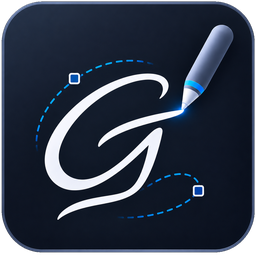
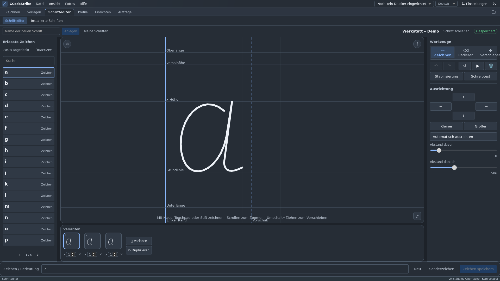
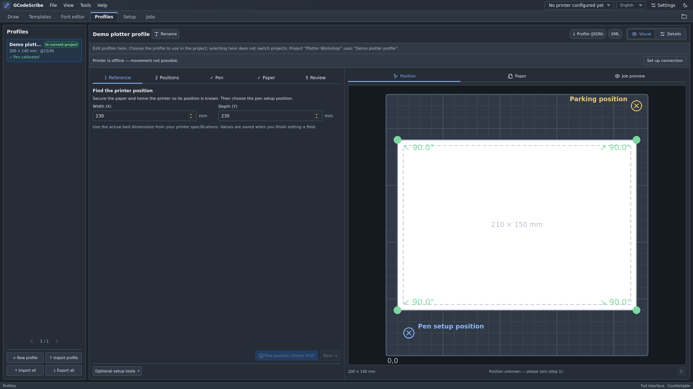

<p align="center">
  
</p>
<h1 align="center">GCodeScribe</h1>
<p align="center"><strong>Your ideas. Your handwriting. Your pen plotter.</strong><br>Create drawings, documents and custom stroke fonts, then bring them to paper with G-code.</p>
<p align="center">
  <a href="https://github.com/Friedjof/gcodescribe/releases/latest"></a>
  <a href="https://github.com/Friedjof/gcodescribe/actions/workflows/release.yml"></a>
  
  
</p>
<p align="center"><a href="#installation">Installation</a> · <a href="#what-you-can-do">Features</a> · <a href="#build-your-pen-holder">Print files &amp; materials</a> · <a href="docs/screenshots.md">Screenshot gallery</a> · <a href="docs/releases/0.6.3.md">New in v0.6.3</a></p>

<table>
  <tr>
    <td width="50%"><a href="media/screenshots/design-overview.png"></a><br><strong>Draw and compose</strong><br>Arrange objects, custom lettering and patterns on a precise drawing area.</td>
    <td width="50%"><a href="media/screenshots/font-editor.png"></a><br><strong>Develop your handwriting</strong><br>Build characters from real pen strokes and refine their variants.</td>
  </tr>
</table>
<table>
  <tr>
    <td width="33%"><a href="media/screenshots/color-layers.png"></a><br><strong>Prepare colour layers</strong><br>Split a drawing across multiple pen colours.</td>
    <td width="33%"><a href="media/screenshots/stl-import.png"></a><br><strong>Turn 3D into line art</strong><br>Orient an STL, choose its edges and inspect the plot preview.</td>
    <td width="33%"><a href="media/screenshots/profile-calibration.png"></a><br><strong>Set up paper and pen</strong><br>Keep paper corners, drawing bounds and pen positions in view.</td>
  </tr>
</table>

All app screenshots use an isolated demo environment with neutral English content. Import the editable [Workshop demo font](media/examples/workshop-demo.gcsfont) to try it yourself. Explore more views in the [screenshot gallery](docs/screenshots.md).

## What you can do

- **Design pages:** Arrange drawings, text and imported artwork. Projects group related pages and use their own calibration profile.
- **Edit handwriting:** Create custom stroke fonts with multiple character variants, try them in the writing test, and import or export `.gcsfont` files.
- **Convert files:** Import SVG, images, PDF, Office documents and native Xournal++ pen strokes. Larger imports run as background tasks.
- **Generate templates:** Create games, mazes, Sudoku, patterns, maps and technical line drawings from STL files.
- **Prepare plots:** Inspect tool paths in 3D, display paper and profile outlines, separate colour layers and export G-code.
- **Manage multiple printers:** Switch between saved USB/serial and OctoPrint connections and test each connection separately.
- **Calibrate and control:** Define paper using four corners or two diagonal corners, calibrate pen heights, and save insertion and parking positions.
- **Use optional AI tools:** Generate and improve images using an OpenAI API key or a Codex/ChatGPT account. The selected provider's limits apply; the app does not automatically switch to API billing.
- **Connect through MCP:** The running desktop app also provides a local, token-protected MCP endpoint with a persistent port.

## Installation

### Linux desktop

Download the appropriate package from the [release page](https://github.com/Friedjof/gcodescribe/releases/latest). Use the **Flatpak** for the standalone GTK/WebKit desktop app:

```sh
flatpak install --user ./GCodeScribe-v0.6.3.flatpak
flatpak run info.noweck.gcodescribe
```

The first launch opens the setup guide. The app can follow your system theme; the small button in the top-right corner switches between light and dark. Printer selection, language and Settings are directly accessible in the header.

### Debian, RPM and AppImage

Releases also include packages for the web application. On Debian/Ubuntu:

```sh
sudo apt install ./gcodescribe_0.6.3_amd64.deb
gcodescribe-web
```

Then open `http://localhost:8000`. The Python application requires Python 3.12 or later. RPM and AppImage downloads are available on the same release page.

### Docker Compose

```sh
cp .env.example .env
docker compose up --build
```

The web interface is available at `http://localhost:8000` by default. Configure connections, optional AI features and the published port in `.env`. Set `PLOTTER_HOST_PORT` to use a different host port.

To use the prebuilt container image:

```sh
docker compose -f compose.yml -f compose.prod.yml up -d
```

## From first launch to first plot

1. **Choose a profile and project.** Set bed dimensions, paper size and drawing bounds to match your machine.
2. **Connect a printer.** Configure USB/serial or OctoPrint and run the connection test.
3. **Calibrate paper and pen.** Follow the guided steps for homing, paper corners, the insertion position and pen heights. Entering the paper view raises the pen.
4. **Design a page.** Add an example file, template or drawing and arrange it within the drawing area.
5. **Preview and plot.** Check tool paths, profile outlines and colour layers, then generate G-code or start plotting.

Switching printers invalidates the previously known position. Home the selected printer again and check its profile. Printer switching is locked during running or paused plots.

## Build your pen holder

The included hardware is designed for the **Anycubic i3 Mega S (Ai3MS)**. Software version **v0.6.3** and hardware revision **v2** are independent.

<table>
  <tr>
    <td width="45%"><a href="media/hardware/pen-mount-printer.jpg"></a><br>The pen holder on the toolhead. This existing assembly photo illustrates the mechanism; the v2 CAD files define the current design.</td>
    <td width="55%"><a href="media/screenshots/stl-import.png"></a><br>The current v2 model as a 3D view and projected line drawing.<br><br><a href="media/hardware/automaticchickenfeeder-plot.png">Example: a plotted construction drawing</a></td>
  </tr>
</table>

### What you need

| Material | Quantity |
|---|---:|
| Small magnets, 5 mm diameter | 10 |
| M3 threaded inserts | 2 |
| M3 screws | 2 |
| Filament for the three printed parts | As required by your print profile |
| Medium-sized rubber band | 1 |
| Liquid superglue | As needed |

**Tools:** a matching hex key and, optionally, a small hammer for inserting the magnets. Check magnet thickness, insert dimensions and screw length against the v2 design and your actual components before assembly.

### Download print parts and CAD

| File | Purpose |
|---|---|
| [All three v2 STLs as a ZIP](https://github.com/Friedjof/gcodescribe/releases/download/v0.6.1/GCodeScribe-Ai3MS-v2-print-parts.zip) | Download all print parts together |
| [Printer mount · mount.stl](media/models/GCodeScribe-Ai3MS-v2-mount.stl) | Attachment to the machine |
| [Pen holder · pen.stl](media/models/GCodeScribe-Ai3MS-v2-pen.stl) | Pen attachment |
| [Plate · plate.stl](media/models/GCodeScribe-Ai3MS-v2-plate.stl) | Matching plate for the assembly |
| [v2 STEP model](media/models/GCodeScribe-Ai3MS-v2.step) | Editing in other CAD systems |
| [v2 Fusion design](media/models/GCodeScribe-Ai3MS-v2.f3d) | Native design file |

See the [model overview](media/models/README.md) for dimensions, assembly steps and file descriptions. Earlier designs are archived under [`media/models/old/`](media/models/old/).

## AI, MCP and notifications

**AI access:** Open **Settings → AI Designer → Access** to choose between an API key and Codex. The Flatpak includes the Codex CLI. Other installations require the [official Codex CLI](https://developers.openai.com/codex/cli) on the backend machine. Sign in using the displayed one-time code and official login link. Account credentials are stored separately in the app's private data directory.

**MCP:** Enable MCP under **Settings → MCP**, create a token and copy the displayed URL into your client. Keep the app running for desktop connections. [Desktop MCP and connection test details](docs/desktop-interface.md).

**Notifications:** Enable notifications through **Tools → Notify** and run the test. Browsers require `localhost` or HTTPS and notification permission; the desktop app uses system notifications. Keep the application open; it can be minimised. The small task bell shows background work and results.

## Development

```sh
make setup
make dev
```

Use `make dev-plain` for a non-interactive start. The frontend development server watches files using polling; run `CHOKIDAR_USEPOLLING=false make dev` to use native file watching.

```sh
uv run pytest
uv run ruff check .
npm --prefix frontend test
npm --prefix frontend run build
```

`make deb`, `make rpm`, `make appimage` and `make packages` build installation packages. See the [release notes](docs/releases/0.6.3.md) for the current changes.
