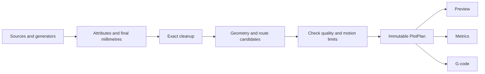

# Evaluation: from drawing to efficient plot

As of 16 November 2026. Production version examined: `f62512b`, branch `interface-refactoring`. This supplements the [pen-width plan](pen-width-optimization-plan.md) without changing the production pipeline. Measurements are offline experiments, not measured plotting times.

## Findings and priorities

The largest benefit comes from combining complete, correct source geometry, a shared plot plan, improved routes and then pen-aware geometry. Blanket Fewer points or Never lift settings would amplify some existing quality problems.

Three kinds of work are needed:

1. **Correct quality errors:** reduced previews enter plot data, parallel traced strokes can collapse, and dashing/fills can change shapes.
2. **Traverse existing paths more efficiently:** optimise order, direction and closed-contour starts, accounting for actual start/park positions and obstacles. These improvements need no intentional geometry loss.
3. **Generate fewer ink paths:** remove identical/covered paths, adapt hatching to pen/tone, and weigh retracing against lifting. This requires stroke roles and pen conditions.

Shorter drawing distance succeeds only when artwork is preserved. Shorter travel initially leaves contacts unchanged. Fewer coordinates reduce data/computation, not necessarily physical drawing distance.

## Existing behaviour

| Path | Behaviour | Consequence |
| --- | --- | --- |
| Designer → `gcode/scene.py` | Transform/mask → merge → default Continuous retracing → greedy sort → machine coordinates → G-code | No 2-opt; routes evaluated before coordinate conversion; retracing is not cost-based |
| SVG/placement → `artwork/drawing.py` | Merge/Continuous/sort in source coordinates, then final scaling | Joining tolerance's physical effect changes with placement size |
| CLI → `artwork/pipeline.py` | vpype with separate simplification/layout/sorting | Similar inputs follow different rules |
| Gallery/source → designer | Some reduced preview paths are saved as `basePolylines`/`cachedPolylines` | Better routing cannot restore lost detail |
| Score / 3D preview / job | Each invokes G-code generation | A common function helps, but a shared versioned plan is missing |

Relevant locations: `plotter/gcode/scene.py:250`, `:332`, `:393`; `plotter/artwork/drawing.py:217`, `:239`; `plotter/artwork/pipeline.py:118`; `plotter/web/routes/pages.py:574`; `frontend/src/features/paint/lib/insertAsset.ts:28`.

## Measurements and limitations

Reproduction scripts and raw data: [experiments/plot-efficiency](../experiments/plot-efficiency/README.md). Savings from separate experiments **cannot be added together**.

| Experiment | Result | Interpretation |
| --- | --- | --- |
| App maze, size 24, 190 merged paths, Continuous off | Travel 2602.3 → 2144.2 mm, **−17.6%** | Existing SVG 2-opt versus scene greedy; isolated ordering in 190×270 source mm, 0.001 mm merge, start 0/0, no parking |
| Same maze, Continuous on | Four paths; **no 2-opt benefit** | Benefits depend strongly on artwork and preceding routing |
| 120 synthetic closed rings, four seeds | **7.9–19.4% less travel** through seam/order changes | Exact segment multiset preserved; no parking comparison |
| Six app motifs, direction DP with fixed order | **0–5.89% less travel** | Includes approach/parking and Y flip; under 1 ms each locally; contacts/segments unchanged |
| 4,000 synthetic paths, use the existing KD-tree earlier | Same route length; latest sorting time **7.07 → 0.30 s** | Host-load-sensitive local timings; current threshold is 4,001 |
| Omit repeated F words in real Truchet/wave/hex templates | **17.2–22.9% fewer transmission bytes** | Identical modal `(G,X,Y,Z,F)` movements; no measured machine-time saving |
| Identical straight 100 mm line, 2 versus 10,001 points | App estimate **6.6 → 343.9 s** | Same drawing/travel distance and one contact; exposes time-model sensitivity |
| 0.1 mm line with 1,001 points | **900 zero-length XY moves** after rounding | Exact cleanup can remove unnecessary commands |

The default mode exposes these trade-offs on actual app generators. Controls use identical merging, transforms and rounding; only `continuous` changes:

| Motif, seed `pipeline-audit` | Without Continuous: drawing / contacts / travel | With Continuous: drawing / contacts / travel |
| --- | --- | --- |
| Wave field, complexity 0.8 | 8582.8 mm / 42 / 649.3 mm | 14744.4 mm / 10 / 701.9 mm |
| Classic maze, size 45 | 8139.5 mm / 437 / 3311.1 mm | 17992.8 mm / 4 / 708.7 mm |

The waves use 71.8% more drawing distance to save 32 contacts, with more travel too. The maze uses 121.1% more drawing to save 433 contacts. Actual speed/appearance depend on lifting mechanics, speed and ink deposition. Evaluate both candidates instead of selecting the fewest contacts alone.

For a 20×20 mm rectangle with nine hatch lines, proper boundary junctions reduce **10 → 1 strokes** but increase drawing **260 → 294 mm**. The geometric line set is unchanged; 34 mm is retraced. Graph construction and routing belong together; a line-set check alone cannot prove identical deposition.

[Maze comparison](../experiments/plot-efficiency/results/routing-maze.svg): black drawing paths, dashed red travel. [Obstacle comparison](../experiments/plot-efficiency/results/routing-obstacle.svg): constructed example, with actual travel of 1180.9 mm for straight-line ordering versus 427.2 mm for obstacle-aware ordering. This large difference exposes a weakness, not a typical universal saving.

## Quality issues to address first

**Preview reduction becomes plot input.** `asset_pages.render_drawing` and `gallery.previews.preview_from_drawing` take every nth point and round to 0.01 mm. `insertAsset.ts` saves those paths; `GalleryPopup.tsx` also uses them for quick plots. Xournal already has a separate full-resolution path. A synthetic 40,401-point input loses 20,100 spikes, with 0.5 mm maximum source-coordinate deviation. The apparent reduction from 28425.7 to 20100 mm is an error.

Provide explicit full geometry or referenced source revisions for all imports, separate from display LOD. Bind size/transforms to the source. Do not silently replace existing reduced objects: check source, revision and later edits, and offer a deliberate previewed reimport. Raising a preview limit merely postpones the problem.

**Centreline detection can collapse separate strokes.** `trace.py:342–419` transitively groups similarly directed overlapping strokes within 2 mm. The actual centreline path turns ten black lines spaced 1.27 mm apart into one in the experiment, using source mm, detail 3 and `uniform_ink=True`, as in SVG handwriting import. At 3.175 mm spacing it retains ten. Another test collapses a 10 mm-wide band through transitive pair relationships. This is not reliable duplicate detection. Require local shape/coverage checks, a whole-group bound and pen awareness. Tone-driven omission and repeated passes are currently automatic heuristics; expose choices/provenance so later optimisation preserves deliberate emphasis without treating accidental loss as required.

**Stroke styles lose geometry.** `styling.ts:78` replaces each dash with a straight line between two samples. A single 10 mm dash on a 10 mm right-angled polyline becomes a 7.071 mm diagonal; the corner is 3.536 mm away. Retain intermediate vertices inside dash intervals. Filling uses only one contour (`:108`, `:179`); five hatch lines cross an intended 10×10 mm hole. Compound paths need correct outer/inner rings and fill rules; nesting alone does not imply a hole.

**Dots are currently crosses.** `styling.ts:89`/`:164` creates two lines per mark; eleven dots become 22 input paths. Explicit dot contacts might reduce paths/transitions but deposit different ink. Determine the footprint, intended size and contact time first; do not silently reinterpret crosses as dots.

**Joining tolerance and obstacles:** internal `merge_polylines` uses rounded grid cells, not Euclidean distance. This is separate from vpype's SVG merge. Nearby endpoints across cell boundaries can remain separate; more distant endpoints in one cell can collapse. Numerical junction identity, permitted gap joining and pen width need separate parameters. The obstacle planner also lacks bed bounds: it can choose an off-bed detour despite a valid opposite-side route. The reproduction's Y = −3.05 route is correctly rejected by safety checks; its Y = 143.05 alternative passes. Retain final safety checks and search valid in-bed alternatives.

## Improve routes without thinning artwork

### Consider order, direction and contour starts together

Existing ordering starts at source `(0,0)`. Relevant context is the agreed machine-coordinate job start, previous fixed group's endpoint, parking, mirroring and obstacles. If start position is unknown, the start protocol must establish it or represent the uncertainty explicitly.

For reversible strokes:

1. Apply final transforms and form permitted groups.
2. Quickly construct a greedy route using a spatial index.
3. Optimise directions jointly for fixed order. A two-state dynamic programme is linear; the prototype checks small cases against every orientation.
4. Improve locally with 2-opt, stroke relocation and small neighbourhood searches. Bound candidates/iterations for large files rather than disabling improvement above a hard stroke count.
5. Start closed contours at more suitable existing vertices, considering both arrival and departure. Seam rotation preserves drawn segments; a new start within a segment needs an additional numerically checked split.
6. Compare actual obstacle-aware routes against the original and accept only valid improvements.

Protect order/direction for handwriting, variable speed/pressure, brush direction or intentional deposition. Reversal may also require reversing per-segment attributes correctly. Avoid concentrating every contour seam at a visually dominant location: shortest travel and unobtrusive seams are distinct objectives.

### Weigh lifting against retracing

`continuous=True` aims for one stroke per connected component by retracing existing edges. It may be faster, but can darken junctions, create blobs or repeat long paths unnecessarily.

An undirected connected network with `o` odd-degree nodes needs at least `max(1, o/2)` strokes without retracing, assuming correctly split junctions and free directions. `singlepass.py` uses this principle, but its virtual lift connections do not optimise subsequent travel. `oneline.py` also chooses open endpoints/additional paths heuristically.

Generate multiple candidates per compatible subnetwork: once per edge, continuous and hybrid. Hybrid may repeat short existing paths when this replaces a costlier lift and extra ink is acceptable; split long branches. Pair odd nodes spatially/by cost, using more exact small-network matching as a reference and bounded large-network search. This does not promise a global optimum for arbitrary disconnected networks.

A possible criterion is:

`T ≈ drawing motion + travel motion + lift/lower cycles + relevant transmission bottlenecks`

Also enforce hard shape/order/repeated-ink limits. Add no visible connection through white space. A centreline inside existing ink does not prove its entire pen footprint is covered.

## Pen-aware geometry and better generation

The earlier pen-width plan remains the basis for coverage, error budgets, protected details and calibration. Priorities include:

- Normalise exact/partial duplicate overlaps independently of subdivision, retaining deliberate shading/multiple passes.
- Remove collinear samples and identical movements after 0.001 mm rounding only when pressure, feed and dot-contact meaning stay unchanged.
- Sample curves with a budget in **final millimetres**, not every nth point. Protect corners, junctions and small holes.
- Regenerate fills from original regions using width, tone and islands/holes. Join serpentine paths only inside permitted fill. Investigate contour-parallel and alternating hatching as explicit styles rather than assuming equivalence.
- Prefer centrelines/actual stroke fonts for suitable line art/lettering. Outlines and regions require different treatment; skeletonisation is not a universal replacement for imported contours.
- Remove hidden lines according to actual fills and layer intent. An overlapping transparent stroke is not an opaque mask.

Later experiments include G2/G3 arc fitting, curvature/corner-aware speed and drying-aware order. They require firmware/parser support, reliable motion models and physical tests first. Smaller Z lifts are not a purely software optimisation: paper waviness, safe clearance and obstacles remain constraints.

## Architecture, responsiveness and measurement

A shared immutable `PlotPlan` separates generation, optimisation and encoding. It records source/object, role, pen group, direction protection, pressure/speed, final geometry, paths, metrics and validation. Bind the chain to document/source revision, profile/pen fingerprints and optimiser version.

A shared preview/score/plot plan avoids divergent re-optimisation. Cache object geometry, page routes and static profile obstacle graphs; cancel superseded work. Define deterministic search limits with wall-clock cancellation as an extra safeguard. On cancellation retain the best validated candidate. Dense overlaps require dedicated load tests; a spatial index alone does not guarantee good runtime.

`gcode/metrics.py:18` assumes acceleration/braking and 25 ms overhead per movement, plus 150 ms for Z. Sampling density therefore changes its estimate dramatically even for the same straight line. Do not use this alone for automatic quality choices. Firmware can look ahead across segments; `ok` does not imply every segment physically stops at zero speed.

The serial sender waits for `ok` after every line (`serial/worker.py:506`). Fewer commands and omission of unchanged modal F words can help. A larger buffer needs a separate protocol design for backpressure, errors, pause/cancel and retransmission, not blind advance sending. Transmission and movement may overlap; do not simply add their lower bounds.

Initially offer three understandable modes: **Original**, **Optimise travel**, **Consider pen**. Describe Continuous explicitly as Allow retracing. Show drawing/travel distances, contacts, repeated distance, data size, quality deviation and a separately labelled time estimate. Existing score weights sometimes reward longer drawing, so score is not an optimisation objective. Original/result previews with physical width and optional travel remain central.

## Implementation sequence and acceptance

| Package | Scope | Acceptance |
| --- | --- | --- |
| A – Input quality | Separate full geometry from previews; correct centreline consolidation, dashes and contour holes | Dense imports retain detail; parallel strokes, corners and holes survive regressions |
| B – Shared plan | Attributes/final mm, adapters, identity mode and cache | Identical identity-mode motion, shared preview/G-code plan IDs, no stale responses |
| C – Lossless routing | Spatial index, direction DP, bounded 2-opt, existing-vertex contour starts, bed/obstacle limits | Unchanged segment multiset/protected groups, valid final G-code, travel never worse than baseline |
| D – Pen model/cleanup | Width/uncertainty, redundant paths, safe simplification, error previews | Local/global quality, details/white space and metadata checked |
| E – Hybrid/fills | Lifting versus retracing, generator-aware filling, realistic timing | Compare Original/Once/Hybrid on identical motifs; document repeated deposition/physical results |
| F – Output/transport | Modal compaction; optional arcs/streaming after separate validation | Identical modal motion/feed; parser, safety, pause/cancel and reproducible DEB/Flatpak checks |

Separate fixes, models, algorithms and UI commits within each package. These refine the earlier pen-width stages: source fidelity and simple route improvements should precede area-based removal.

Use fixed-seed app generators, dense SVGs, stroke fonts, pressure-bearing Xournal, map junctions, fills with holes, multiple colours, punctuation, boundary obstacles and the same artwork at multiple sizes. Measure quality, contacts, drawing/travel, planning time, peak memory, file size and later actual plotting time separately. Physical comparisons with fine/broad pens and different papers are still needed for quality/timing claims.

## Comparison with established tools

[vpype](https://vpype.readthedocs.io/en/latest/reference.html) separates merging, simplification and sorting, with optional 2-opt and random seam placement using `reloop`. Use existing tools as comparisons; travel-aware seam rotation would be a separate targeted choice.

[AxiDraw](https://www.axidraw.com/doc/cli_api/) respects layers when sorting, optionally reverses paths, and offers hidden-line removal and a saved plot digest. Group/direction protection and stable plans are better models than indiscriminately sorting everything. Its reported timing gains do not transfer to GCodeScribe.

[DrawingBotV3](https://docs.drawingbotv3.com/en/stable/exportsettings.html) separates simplification, merging, sorting and multiple passes. This supports separate decisions; its length filter would be unsuitable for tiny lettering dots without semantic/pen checks.

These measurements, priorities and proposals are project-specific assessments. References do not establish our physical quality limits.

## Validation performed

All five scripts ran. Direction optimisation passes nine small exhaustive comparisons; routing candidates preserve undirected segment multisets. The pipeline measures thirteen cases with repeatable rendering and checks modal-F output movement by movement. Quality reproductions use production import/style functions. The obstacle case checks both rejection and a valid alternative with the actual safety checker. Python lint passed; both SVG comparisons were inspected in isolated Firefox. Production code, user data and hardware were unchanged. Full app suites were not repeated for this evaluation-only work.
