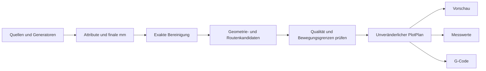

# Evaluation: von der Zeichnung zum effizienten Plot

Stand: 16. November 2026. Untersuchte Produktionsversion: `f62512b`, Branch
`interface-refactoring`. Diese Arbeit ergänzt die
[Stiftbreitenplanung](pen-width-optimization-plan.md). Sie ändert keine
Produktionspipeline. Messungen sind Offline-Versuche, keine gemessenen Plotzeiten.

## Ergebnis und Priorität

Der größte Nutzen kommt aus einer Kombination: vollständige und richtige
Eingangsgeometrie, ein gemeinsamer Plotplan, bessere Routen und anschließend
stiftabhängige Geometrie. Eine globale Einstellung „weniger Punkte“ oder „niemals
absetzen“ würde einige vorhandene Qualitätsprobleme verstärken.

Die Evaluation findet drei Arten von Arbeit:

1. **Qualitätsfehler beheben:** reduzierte Vorschauen gelangen in Plotdaten;
   parallele Linien können beim Nachzeichnen zusammenfallen; Strichelung und
   Füllungen können die Form verändern.
2. **Vorhandene Linien günstiger abfahren:** Reihenfolge, Richtung und Startpunkt
   geschlossener Konturen verbessern; reale Start-/Parkpunkte und Hindernisse
   einbeziehen. Hier gibt es Verbesserungen ohne absichtlichen Geometrieverlust.
3. **Weniger Tintewege erzeugen:** identische/überdeckte Strecken entfernen,
   Schraffuren auf Stift und Tonwert abstimmen, Nachzeichnen gegen Absetzen
   abwägen. Dafür müssen Strichrolle und Stiftbedingungen bekannt sein.

Ein kürzerer Zeichenweg ist nur dann ein Erfolg, wenn das Motiv erhalten bleibt.
Kürzere Leerfahrten ändern die Anzahl der Stiftkontakte zunächst nicht. Weniger
Koordinaten senken Datenmenge und Rechenaufwand, aber nicht automatisch die
physische Zeichenstrecke.

## Was heute tatsächlich passiert

| Pfad | Verhalten | Konsequenz |
| --- | --- | --- |
| Designer → `gcode/scene.py` | Transformation/Masken → Merge → standardmäßig kontinuierliches Nachzeichnen → Greedy-Sortierung → Maschinenkoordinaten → G-Code | Kein 2-opt; Wege werden vor dem Koordinatenwechsel bewertet; Nachzeichnen ist keine Kostenentscheidung |
| SVG/Platzieren → `artwork/drawing.py` | Merge/Continuous/Sortierung in Quellkoordinaten, danach endgültige Skalierung | Verbindungstoleranz verändert ihre physische Wirkung mit der Platzierungsgröße |
| CLI → `artwork/pipeline.py` | vpype mit eigener Vereinfachung/Layout/Sortierung | Vergleichbare Eingaben durchlaufen unterschiedliche Regeln |
| Galerie/Quelle → Designer | teilweise reduzierte Preview-Polylinien werden als `basePolylines`/`cachedPolylines` gespeichert | Verlorene Details sind später durch bessere Routen nicht wiederherstellbar |
| Score / 3D-Vorschau / Job | rufen jeweils die G-Code-Erzeugung auf | Gleiche Grundfunktion ist gut; ein versionierter gemeinsam verwendeter Plan fehlt |

Relevante Stellen: `plotter/gcode/scene.py:250`, `:332`, `:393`;
`plotter/artwork/drawing.py:217`, `:239`; `plotter/artwork/pipeline.py:118`;
`plotter/web/routes/pages.py:574`; `frontend/src/features/paint/lib/insertAsset.ts:28`.

## Messungen und ihre Grenzen

Reproduzierbare Skripte und vollständige Rohdaten liegen unter
[experiments/plot-efficiency](../experiments/plot-efficiency/README.md).
Verbesserungsprozente verschiedener Versuche sind **nicht addierbar**.

| Versuch | Ergebnis | Einordnung |
| --- | --- | --- |
| App-Labyrinth, Größe 24, 190 Wege nach Merge, Continuous aus | 2.602,3 → 2.144,2 mm Leerweg, **−17,6 %** | Vorhandenes SVG-2-opt gegen Scene-Greedy; isolierter Sortiervergleich in 190×270 Quell-mm, Merge-Toleranz 0,001 mm, Start 0/0, ohne Parkfahrt |
| Dasselbe Labyrinth, Continuous an | 4 Wege; **kein Vorteil** durch 2-opt | Verbesserungen hängen stark vom Motiv und vorherigen Routing ab |
| 120 synthetische geschlossene Ringe, vier Seeds | **7,9–19,4 % weniger Leerweg** durch andere Nahtwahl/Reihenfolge | Exakte Segment-Multimenge erhalten; keine Parkfahrt im Vergleich |
| Sechs App-Motive: Richtungs-DP bei unveränderter Reihenfolge | **0–5,89 % weniger Leerweg** | Anfahrt/Parken und Y-Flip enthalten; im lokalen Lauf jeweils unter 1 ms; Kontakte/Segmente unverändert |
| 4.000 synthetische Wege: vorhandenen KD-Baum früher nutzen | Gleiche Weglänge; im letzten Lauf **7,07 → 0,30 s** Sortierzeit | Lokale Laufzeiten schwanken mit Hostlast; Schwelle ist aktuell erst 4.001 |
| Wiederholte F-Wörter im G-Code realer Truchet-/Wellen-/Hex-Vorlagen auslassen | **17,2–22,9 % weniger Übertragungsbytes** | Jede modale Bewegung `(G,X,Y,Z,F)` identisch; keine gemessene Maschinenzeitersparnis |
| Identische gerade 100-mm-Linie, 2 bzw. 10.001 Punkte | App-Zeitschätzung **6,6 → 343,9 s** | Gleicher Zeichenweg, Leerweg und ein Kontakt; zeigt Empfindlichkeit des Zeitmodells |
| 0,1-mm-Linie mit 1.001 Punkten | **900 XY-Nullbewegungen** nach Ausgaberundung | Exakte Bereinigung kann unnötige Befehle vermeiden |

Der Standardmodus erzeugt auf realen App-Generatoren folgende Zielkonflikte.
Die Kontrollläufe verwenden dieselben Merge-/Transformations-/Rundungsregeln;
geändert wird nur `continuous`:

| Motiv (Seed `pipeline-audit`) | Ohne Continuous: Zeichenweg / Kontakte / Leerweg | Mit Continuous: Zeichenweg / Kontakte / Leerweg |
| --- | --- | --- |
| Wave-field, Komplexität 0,8 | 8.582,8 mm / 42 / 649,3 mm | 14.744,4 mm / 10 / 701,9 mm |
| Klassisches Labyrinth, Größe 45 | 8.139,5 mm / 437 / 3.311,1 mm | 17.992,8 mm / 4 / 708,7 mm |

Die Wellen brauchen 71,8 % mehr Zeichenweg für 32 gesparte Kontakte; auch der
Leerweg steigt. Beim Labyrinth stehen 121,1 % mehr Zeichenweg 433 gesparten
Kontakten gegenüber. Welcher Fall physisch schneller oder schöner wird, hängt
von Hubmechanik, Geschwindigkeit und Tintenauftrag ab. Beide Kandidaten sind
deshalb zu bewerten, statt allein die kleinste Kontaktzahl zu wählen.

Ein weiterer Versuch zeigt die Wirkung korrekter Knoten: Bei einem 20×20-mm-
Rechteck mit neun Schraffurlinien ergeben echte Randanschlüsse **10 → 1 Zug**,
aber **260 → 294 mm** Zeichenweg. Die geometrische Linienmenge bleibt gleich,
34 mm werden zusätzlich nachgefahren. Verbindungsgraph und Routenwahl gehören
zusammen; eine Linienmengenprüfung allein bestätigt keinen gleichen Tintenauftrag.

[Labyrinthvergleich](../experiments/plot-efficiency/results/routing-maze.svg):
schwarz Zeichnung, rot gestrichelte Leerfahrten.
[Hindernisvergleich](../experiments/plot-efficiency/results/routing-obstacle.svg):
konstruiertes Beispiel, Luftlinien-Sortierung 1.180,9 mm tatsächliche Leerfahrt,
hindernisbewusste Sortierung 427,2 mm. Das starke Ergebnis zeigt eine Schwachstelle,
keine typische pauschale Einsparung.

## Qualitätsbefunde, die zuerst behandelt werden sollten

**Vorschaureduktion wird zum Plotinput.** `asset_pages.render_drawing` und
`gallery.previews.preview_from_drawing` nehmen jeden n-ten Punkt und runden auf
0,01 mm. `insertAsset.ts` übernimmt diese Linien dauerhaft; `GalleryPopup.tsx`
verwendet denselben Weg auch zum Schnellplot. Xournal hat bereits einen separaten
Vollauflösungsweg. Bei einem synthetischen Motiv mit 40.401 Punkten verschwinden
20.100 Zacken; die maximale Abweichung beträgt 0,5 mm in Quellkoordinaten. Die
scheinbare Wegersparnis von 28.425,7 auf 20.100 mm ist hier ein Fehler.

Vorschlag: explizite Vollgeometrie-Schnittstelle bzw. referenzierter Quellstand für
alle Importarten, getrennte Anzeige-LOD. Größe und Transformation gehören an die
Quelle. Bestehende reduzierte Objekte nicht stillschweigend ersetzen: Quelle,
Revision und nachträgliche Bearbeitung prüfen; Wiederherstellung als bewusster
Neuimport mit Vorschau ermöglichen. Nur ein höheres Preview-Limit verschiebt das
Problem.

**Mittellinien-Erkennung kann getrennte Striche zusammenziehen.**
`trace.py:342–419` gruppiert ähnlich gerichtete, überlappende Striche mit bis zu
2 mm Abstand transitiv. Der echte Centerline-Pfad macht im Versuch aus zehn
schwarzen Linien mit 1,27 mm Abstand eine einzige (Quell-mm, Detail 3,
`uniform_ink=True`, wie beim SVG-Handschriftimport). Bei 3,175 mm Abstand bleiben
zehn. Ein weiterer Versuch zeigt: transitive Paarbeziehungen können sogar ein
10 mm breites Band auf einen Strich reduzieren. Das ist kein verlässlicher
Dublettenbeweis. Kandidaten brauchen lokale Form-/Abdeckungsprüfung, eine
Begrenzung der ganzen Gruppe und Stiftbezug. Tonwertbedingtes Weglassen und
Doppelfahren sind heute automatische Heuristiken. Sie brauchen eine sichtbare
Auswahl und Herkunftsmetadaten, damit ein späterer Optimierer bewusst gewünschte
Betonung nicht entfernt und unbeabsichtigten Verlust nicht für notwendig hält.

**Strichstile verlieren Geometrie.** `styling.ts:78` ersetzt jeden Dash durch eine
Gerade zwischen zwei Abtastpunkten. Ein einzelner 10-mm-Dash auf einer ebenfalls
10 mm langen rechtwinkligen Polyline wird im Versuch zu einer 7,071 mm Diagonale;
der Knick liegt 3,536 mm daneben. Dash-Intervalle
müssen die dazwischenliegenden Stützpunkte behalten. Die Füllung verwendet nur
eine Kontur (`:108`, `:179`); im Versuch laufen fünf Schraffurlinien durch ein
beabsichtigtes 10×10-mm-Loch. Compound-Pfade brauchen korrekte Außenringe,
Innenringe und Füllregel; bloße Verschachtelung bedeutet nicht automatisch ein Loch.

**Punkte sind derzeit Kreuze.** `styling.ts:89`/`:164` erzeugt zwei Linien pro
Markierung. Elf Punkte werden zu 22 Eingabepfaden. Ein expliziter Punktkontakt
könnte Wege und Übergänge reduzieren, ist aber ein anderer Farbauftrag. Erst
Stiftabdruck, gewünschte Punktgröße und Kontaktzeit bestimmen; Kreuze nicht
unbemerkt in Punkte umdeuten.

**Verbindungstoleranz und Hindernisse:** das interne `merge_polylines` nutzt
gerundete Rasterzellen, keinen euklidischen Abstand. Das separate vpype-Merge beim
SVG-Laden ist damit nicht gemeint. Sehr nahe Enden auf verschiedenen Zellseiten können
getrennt bleiben; weiter auseinanderliegende Enden derselben Zelle können
zusammenfallen. Numerische Knotengleichheit, freigegebene Lückenverbindung und
Stiftbreite brauchen getrennte Parameter. Der Hindernisplaner kennt zudem keine
Bettgrenzen. Ein Umweg kann außerhalb des Betts liegen, obwohl ein gültiger Weg
auf der anderen Seite existiert. Im Repro wird die Route bei Y = −3,05 korrekt
vom Sicherheitscheck abgelehnt; die Alternative über Y = 143,05 besteht ihn.
Die abschließende Sicherheitsprüfung muss erhalten bleiben; der Planer muss
gültige Alternativen innerhalb des Betts suchen.

## Routen verbessern, ohne die Zeichnung auszudünnen

### Reihenfolge, Richtung und Konturstart gemeinsam betrachten

Heute startet die Sortierung bei Quellpunkt `(0,0)`. Relevant sind der vereinbarte
Jobstart in Maschinenkoordinaten, der letzte Punkt vorheriger fester Gruppen,
Parkposition, Spiegelung und Hindernisse. Bei unbekanntem Start muss das
Startprotokoll ihn festlegen oder die Unsicherheit ausdrücklich berücksichtigen.

Eine pragmatische Folge für umkehrbare Striche:

1. Final transformieren und zulässige Gruppen bilden.
2. Schnell eine Greedy-Route über einen räumlichen Index erzeugen.
3. Für die feste Reihenfolge alle Strichrichtungen gemeinsam optimieren. Ein
   Zwei-Zustands-Dynamikprogramm schafft das in linearer Zeit; der Prototyp prüft
   kleine Fälle gegen sämtliche möglichen Orientierungen.
4. Lokal Reihenfolge verbessern: 2-opt, einzelne Striche umsetzen und kleine
   Nachbarschaften durchsuchen. Für große Dateien Kandidatenzahl/Iterationen
   begrenzen, statt ab einer festen Strichzahl jede Verbesserung abzuschalten.
5. Geschlossene Konturen an einem günstigeren vorhandenen Stützpunkt beginnen.
   Anfahrt **und** Abfahrt beachten. Eine reine Nahtrotation verändert keinen
   gezeichneten Abschnitt; ein neuer Start mitten im Segment benötigt eine
   zusätzliche, numerisch geprüfte Teilung.
6. Kandidaten mit den wirklichen Hinderniswegen bewerten, Originalroute als
   Vergleich behalten und nur zulässige Verbesserungen übernehmen.

Bei Schrift, variabler Geschwindigkeit/Druck, Pinselrichtung oder bewusstem
Farbauftrag bleibt die Quellreihenfolge bzw. Richtung geschützt. Reversal verlangt
gegebenenfalls auch korrekt umgekehrte Segmentattribute. Geschlossene Konturen
sollen nicht alle an einer sichtbar dominanten Naht beginnen; kürzeste Fahrt und
unauffällige Naht sind getrennte Qualitätsziele.

### Absetzen gegen Nachzeichnen abwägen

`continuous=True` macht aus jeder verbundenen Komponente möglichst einen Zug,
indem es vorhandene Strecken erneut zeichnet. Das kann schneller sein, aber auch
dunklere Knoten, Kleckse oder unnötige lange Wiederholungen erzeugen.

Für ein ungerichtetes, verbundenes Netz mit `o` Knoten ungeraden Grades sind ohne
Nachzeichnen mindestens `max(1, o/2)` Züge nötig; Voraussetzung sind korrekt
aufgeteilte Knoten und frei wählbare Richtungen. `singlepass.py` nutzt bereits
dieses Prinzip. Seine virtuellen Hub-Verbindungen optimieren jedoch nicht die
späteren Leerfahrten. Auch `oneline.py` wählt die zwei offenen Endpunkte und
Zusatzwege nur heuristisch.

Vorschlag: pro kompatiblem Teilnetz mehrere Kandidaten erzeugen: einmal je Kante,
kontinuierlich und hybrid. Im Hybrid dürfen kurze vorhandene Wege wiederholt
werden, wenn sie einen teureren Hub ersetzen und der Mehrfachauftrag zulässig ist.
Lange Äste werden getrennt. Ungerade Knoten räumlich/kostenbewusst paaren; für
kleine Netze exaktere Paarung als Referenz, für große Netze begrenzte Suche. Das
ist keine Zusage eines global optimalen Plans für beliebige getrennte Netze.

Entscheidungskriterium ist etwa:

`T ≈ Zeichenbewegung + Leerbewegung + Hub-/Senkzyklen + relevante Übertragungsengpässe`

Hinzu kommen harte Grenzen für Form, Reihenfolge und unerwünschten Mehrfachauftrag.
Keine neue sichtbare Verbindung durch einen weißen Bereich. Selbst eine
Mittellinie innerhalb vorhandener Tinte beweist noch nicht, dass der ganze neue
Stiftstrich abgedeckt wäre.

## Stiftabhängige Geometrie und bessere Erzeugung

Die frühere Stiftbreitenplanung bleibt die Grundlage für Tintenfläche,
Fehlerbudgets, geschützte Details und Kalibrierung. Besonders lohnend sind:

- Exakte und teilweise überlappende Dubletten normalisieren, unabhängig von ihrer
  Unterteilung. Absichtliche Schattierung/Mehrfachdurchgänge behalten.
- Kollineare Zwischenpunkte und nach der 0,001-mm-Ausgabe identische Bewegungen
  entfernen, sofern Druck, Feed oder Punktkontakt dabei nicht geändert werden.
- Kurven mit einem Fehlerbudget in **finalen mm** abtasten. Nicht einfach jeden
  n-ten Punkt entfernen. Ecken, Netzknoten und kleine Löcher schützen.
- Füllungen aus der ursprünglichen Fläche neu erzeugen: Stiftbreite, Tonwert und
  Inseln/Löcher berücksichtigen. Schlangenlinien nur dort verbinden, wo die
  Verbindung zur erlaubten Füllung gehört. Konturparallel oder wechselndes
  Schraffieren als wählbare Stile prüfen; nicht beliebig einander gleichsetzen.
- Für Linienzeichnungen/Schrift Mittellinien bzw. echte Strichschriften bevorzugen,
  wenn das der Vorlage entspricht. Kontur und Fläche brauchen andere Behandlung;
  Skelettierung ist kein allgemeiner Ersatz für alle importierten Umrisse.
- Verdeckte Linien anhand tatsächlicher Objektfüllung und Ebenenabsicht entfernen.
  Ein überlagerter transparenter Strich ist keine deckende Maske.

Spätere Versuche: Bogenanpassung/G2-G3 zur Datenreduktion, adaptives Tempo an
Krümmung und Ecken, Reihenfolge unter Trocknungsbedingungen. Diese folgen erst
nach Firmware-/Parserunterstützung, belastbarem Bewegungsmodell und echter
Stiftprüfung. Ein beliebig kleinerer Z-Hub ist keine reine Softwareoptimierung;
Papierwelligkeit, sichere Freihöhe und Hindernisse bleiben Randbedingungen.

## Architektur, Reaktionszeit und nachvollziehbare Messung

Ein gemeinsamer unveränderlicher `PlotPlan` trennt Erzeugung, Optimierung und
Encoder. Er enthält Quelle/Objekt, Rolle, Stiftgruppe, Richtungsschutz,
Druck/Tempo, endgültige Geometrie, Wege, Kennzahlen und Prüfbericht. Die vollständige
Kette wird an Dokumentrevision, Quelle, Profil-/Stift-Fingerprint und
Optimiererversion gebunden.

Gleicher Plan für Preview, Bewertung und Plot verhindert erneute abweichende
Optimierung. Geometrie-Caches pro Objekt, Route pro Seite, statischer
Hindernisgraph pro Profil; ungültig gewordene Aufgaben abbrechen. Suchgrenzen
deterministisch definieren, Wallclock-Abbruch nur als zusätzliche Absicherung.
Bei Abbruch den besten bereits geprüften Kandidaten behalten. Große dichte
Überlagerungen brauchen eigene Lasttests; ein räumlicher Index allein garantiert
keine gute Laufzeit.

Die aktuelle Zeitschätzung in `gcode/metrics.py:18` setzt für jeden Bewegungsbefehl
Beschleunigen/Bremsen und 25 ms Zusatzaufwand an, bei Z zusätzlich 150 ms. Damit
verändert bereits die Abtastdichte derselben geraden Linie stark die Schätzung.
Diese Zahl darf eine automatische Qualitätsentscheidung noch nicht allein steuern.
Firmware kann aufeinanderfolgende Segmente planen; ein `ok` bedeutet nicht, dass
jeder Abschnitt physisch bei null Geschwindigkeit endet.

Der serielle Sender wartet je Zeile auf `ok` (`serial/worker.py:506`). Weniger
Befehle und unveränderte modale F-Wörter wegzulassen können helfen. Ein größerer
Sendepuffer braucht dagegen ein eigenes Protokollkonzept mit Rückstau, Fehlern,
Pause/Abbruch und Wiederholung. Nicht einfach mehrere Befehle blind vorab senden.
Übertragungsdauer und Bewegung können überlappen; ihre Untergrenzen nicht pauschal
zur Gesamtzeit addieren.

In der Oberfläche genügen zunächst drei verständliche Varianten:
**Original**, **Wege optimieren**, **Stift berücksichtigen**. Der kontinuierliche
Modus wird zu einer klar beschriebenen Entscheidung „Nachzeichnen erlauben“.
Anzeigen: Zeichenweg, Leerweg, Stiftkontakte, Mehrfachweg, Datenmenge,
Qualitätsabweichung und getrennt eine gekennzeichnete Zeitschätzung. Die bisherigen
Score-Gewichte belohnen teilweise mehr Zeichenweg; der Score ist deshalb kein
Optimierungsziel. Vorschau mit Original/Ergebnis, physischer Stiftbreite und
einblendbaren Leerwegen bleibt entscheidend.

## Umsetzungsfolge und Abnahme

| Paket | Inhalt | Abnahme |
| --- | --- | --- |
| A – Eingangsqualität | Vollgeometrie vom Preview trennen; Centerline-Konsolidierung, Dashes und Konturlöcher korrigieren | Dichte Importe erhalten Details; Parallelstriche, Knicke und Löcher in gezielten Regressionen erhalten |
| B – Gemeinsamer Plan | Attribute/finale mm, bestehende Pfade adapterweise übernehmen, Identitätsmodus und Plan-Cache | Gleiche Bewegungen im Identitätsmodus; Vorschau und G-Code verwenden dieselbe Plan-ID; keine veralteten Antworten |
| C – Routen ohne Formverlust | räumlicher Index, Richtungs-DP, begrenztes 2-opt, Konturstart zunächst nur an vorhandenen Punkten, Bett-/Hindernisgrenzen | Segment-Multimenge unverändert; Schutzgruppen erhalten; gültiger finaler G-Code; gemessene Leerwege nie schlechter als Ausgangskandidat |
| D – Stiftmodell und Bereinigung | Breite/Unsicherheit erfassen, redundante Wege, sichere Vereinfachung, Vorschau mit Fehlerbericht | Lokale und globale Qualitätsgrenzen, Details/Weißräume und Metadaten geprüft |
| E – Hybrid und Füllungen | Hub gegen Nachzeichnen, generatorbewusste Füllung, realistisches Zeitmodell | Original/Einmal/Hybrid auf gleichen Motiven vergleichen; Mehrfachauftrag und physische Ergebnisse dokumentieren |
| F – Ausgabe und Transport | modale Kompaktierung, optional Bögen/Streaming nach separater Prüfung | Gleiche modalen Bewegungen/Feeds; Parser, Sicherheit, Pause und Abbruch geprüft; DEB/Flatpak reproduzierbar |

Innerhalb der Pakete getrennte Commits für Fehlerkorrektur, Modell, Algorithmus
und UI. Die bisherigen Etappen der Stiftbreitenplanung werden dadurch ergänzt:
Quelltreue und einfache Routenverbesserungen sollten früher kommen als
flächenbasierte Entfernung.

Testkorpus: echte App-Generatoren mit festen Seeds, dichte SVGs, Strichschrift,
Xournal mit Druck, Kartenkreuzungen, Schraffuren mit Löchern, mehrere Farben,
kleine Satzzeichen, Randhindernisse und gleiche Motive in mehreren Größen.
Messen: Geometrie/Qualität, Kontakte, Zeichen-/Leerweg, Planungsdauer, Peak-Speicher,
Dateigröße und später reale Plotdauer getrennt. Reale Vergleichsplots mit dünnem
und breitem Stift sowie unterschiedlichen Papieren sind für Qualitäts- und
Zeitversprechen noch erforderlich.

## Vergleich mit etablierten Werkzeugen

[vpype](https://vpype.readthedocs.io/en/latest/reference.html) trennt Merge,
Vereinfachung und Sortierung, bietet optional 2-opt und mit `reloop` zufällige
Nahtpositionen. Daraus folgt für uns: bestehende Werkzeuge als Vergleich verwenden;
Nahtrotation zur Fahrtoptimierung wäre eine eigene, gezielte Auswahl.

[AxiDraw](https://www.axidraw.com/doc/cli_api/) berücksichtigt Ebenen bei der
Sortierung, erlaubt optional Richtungswechsel und bietet Hidden-Line-Removal
sowie einen gespeicherten Plot-Digest. Gruppen-/Richtungsschutz und ein stabiler
Plotplan sind deshalb sinnvollere Vorbilder als ein pauschales Sortieren aller
Linien. Die dort genannten Zeitgewinne lassen sich nicht auf GCodeScribe übertragen.

[DrawingBotV3](https://docs.drawingbotv3.com/en/stable/exportsettings.html) trennt
Vereinfachung, Merge, Sortierung und Mehrfachdurchgänge. Das bestätigt die
Trennung der Entscheidungen; dessen Längenfilter wäre für unsere kleinen
Schriftpunkte ohne Semantik-/Stiftprüfung ungeeignet.

Die Vorschläge, Prioritäten und Messungen hier sind unsere projektspezifische
Bewertung. Die Referenzen sind kein Nachweis für unsere physischen Qualitätsgrenzen.

## Durchgeführte Validierung

Alle fünf neuen Skripte wurden ausgeführt. Die Richtungsoptimierung besteht neun
kleine exhaustive Vergleiche; Routing-Kandidaten prüfen die unveränderte
ungerichtete Segment-Multimenge. Die Pipeline misst 13 Fälle mit wiederholtem
deterministischem Rendering und prüft die Modal-F-Ausgabe bewegungsweise gegen
das Original. Die Qualitäts-Repros verwenden produktive Import-/Stylingfunktionen.
Der Hindernis-Repro prüft sowohl Ablehnung als auch gültige Alternative mit dem
echten Safety-Checker. Python-Lint besteht; beide SVG-Vergleichsbilder wurden
in einem isolierten Firefox visuell geprüft. Produktionscode, Benutzerdaten und
Hardware wurden nicht verändert; die vollständigen App-Suites wurden für diese
reine Evaluation nicht erneut ausgeführt.
