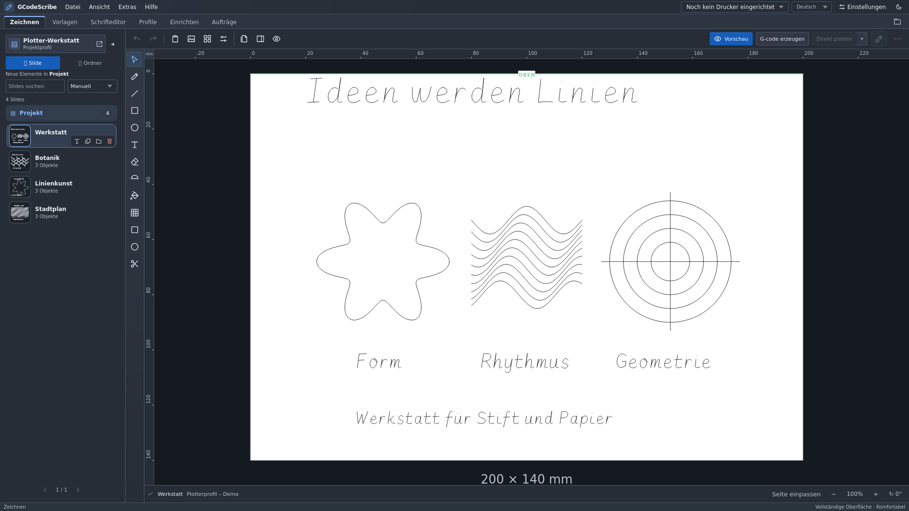
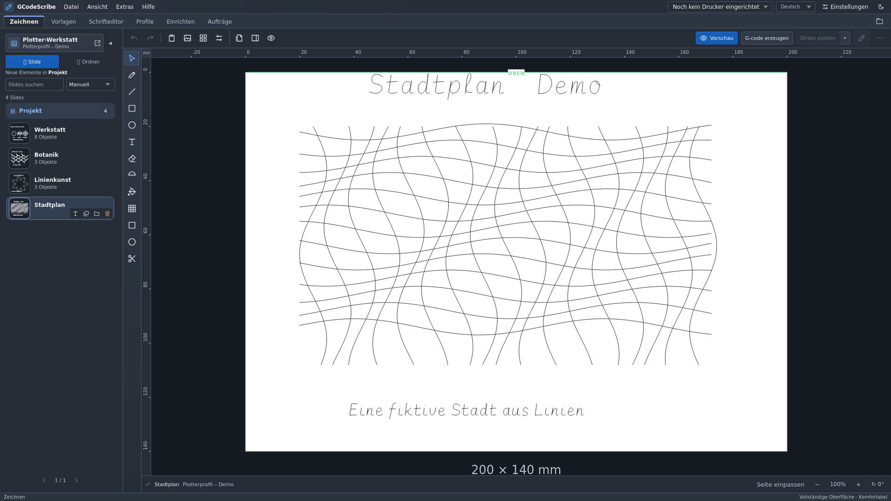
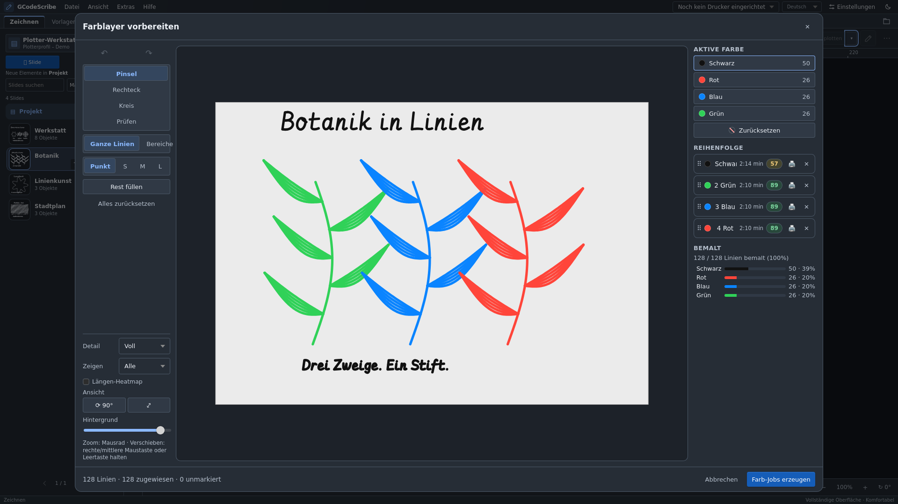
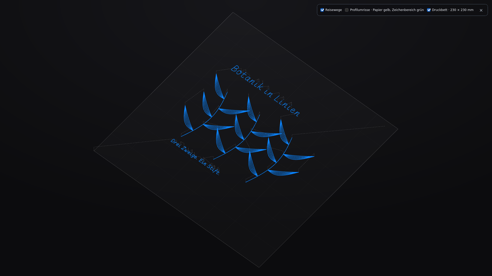
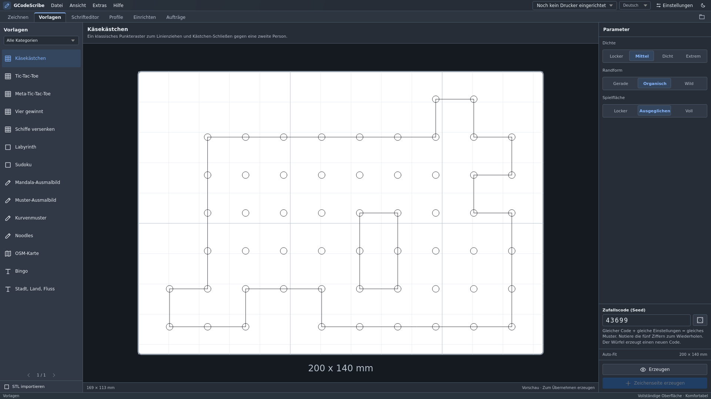
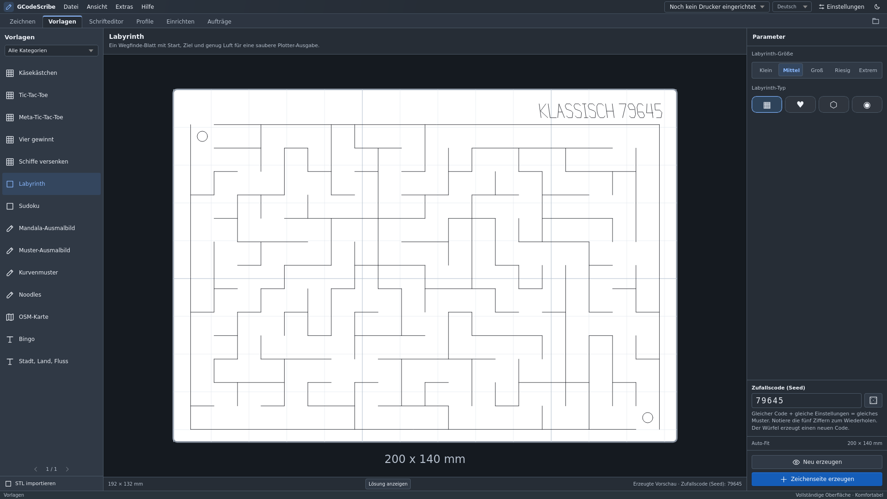

# GCodeScribe in Bildern

Alle Aufnahmen zeigen die deutsche Desktop-Oberfläche im Querformat **1920 × 1080**. Projekte, Zeichnungen und die Stiftschrift sind eigens erstellte Demo-Daten. Es werden keine privaten Projekte, Konten, Druckeradressen oder Personen gezeigt. Ein Klick öffnet jeweils die volle Auflösung.

## Gestalten

### Zeicheneditor · Ideen werden Linien

Mehrere Objekte liegen auf einer gemeinsamen Seite. Links bleibt die Projektstruktur sichtbar; im Zeichenbereich lassen sich Texte, Muster und importierte Linien gemeinsam anordnen.

### Botanische Linienzeichnung

Ein vollständiges Motiv aus offenen Stiftlinien und der Demo-Schrift „Werkstatt“. Die Zeichnung enthält keine Personendarstellung.

### Fiktiver Stadtplan

Das Beispiel zeigt die Anordnung eines umfangreicheren Linienmotivs. Der Stadtplan ist synthetisch und stellt weder einen Wohnort noch einen tatsächlichen Kartenausschnitt dar.

## Eigene Schriften

### Zeichen und Varianten bearbeiten

Die sichtbare Schrift ist ein tatsächlich gespeichertes und bearbeitbares `.gcsfont`-Dokument. Zeichen und ihre Varianten bestehen aus einzelnen Stiftzügen, nicht aus einem Screenshot oder einer gefüllten Textkontur.

[Beispielschrift herunterladen](../media/examples/werkstatt-demo.gcsfont) · [Informationen zum Beispiel](../media/examples/README.md)

### Schreibtest

Im Schreibtest werden mehrere Zeichen der eigenen Schrift gemeinsam dargestellt. Das Beispiel verwendet neutrale deutsche Sätze und zeigt auch Umlaute und Ziffern.

## Plot vorbereiten

### Farblayer

Farben sind einzelnen Liniensegmenten zugeordnet und bleiben mit der Seite gespeichert. Für jede verwendete Farbe kann anschließend ein eigener Auftrag erzeugt werden.

### Technische Zeichnung aus STL

Das Beispiel verwendet die mitgelieferte v2-Druckerhalterung. Alle Einstellmöglichkeiten stehen gemeinsam links; die Mitte zeigt das Modell, rechts erscheint die daraus erzeugte technische Zeichnung.

### Kalibrierungsprofil

Papier, Zeichenfläche und Sonderpositionen gehören zum Demo-Profil. Ein echter Drucker wird für diese Dokumentationsaufnahme nicht bewegt.

### G-Code-Vorschau

Zeichenwege und Leerfahrten lassen sich vor dem Plot kontrollieren. Die große Vorschau bietet getrennte Schalter für Fahrwege, Druckbett und Profilumrisse.

## Vorlagen

### Käsekästchen

Vorlagen passen ihre Abmessungen an den Zeichenbereich an. Wiederholbare Zufallscodes und sichtbare Parameter ermöglichen Varianten desselben Entwurfs.

### Labyrinth

Die erzeugte Zeichnung kann als neue Seite übernommen und anschließend weiterbearbeitet werden.

## Medienstruktur und Herkunft

- `media/screenshots/`: aktuelle, geprüfte Aufnahmen der Anwendung.
- `media/hardware/`: bereitgestellte Montage- und Plotfotos.
- `media/branding/`: bereitgestelltes Icon-Paket, nach Web, PNG, SVG und Desktop sortiert.
- `media/examples/`: importierbare Demo-Schrift.
- `media/models/`: aktueller v2-Drucksatz und CAD-Dateien; ältere Stände liegen unter `old/`.

Die neun ursprünglich im Projekt-Root abgelegten Screenshots wurden durch entsprechende neue Ansichten ersetzt. Die unbearbeiteten Originale bleiben lokal gesichert und sind von Git sowie Release-Archiven ausgeschlossen. Der Zeicheneditor-Überblick und die G-Code-Vorschau ergänzen diese neun Ansichten.
