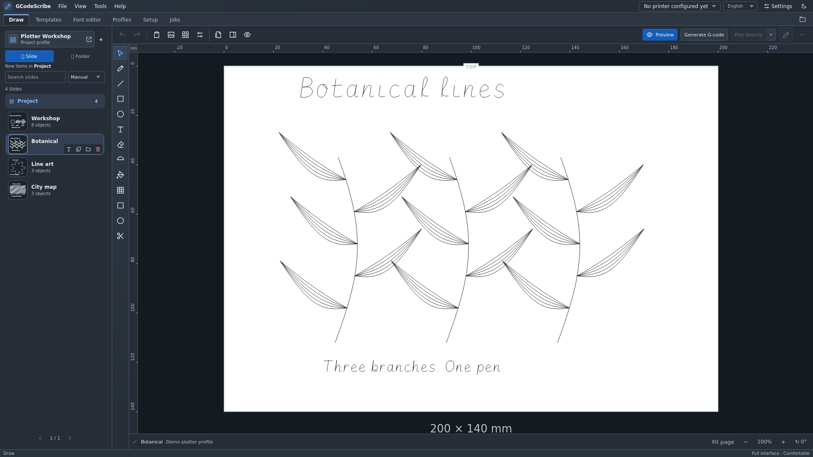
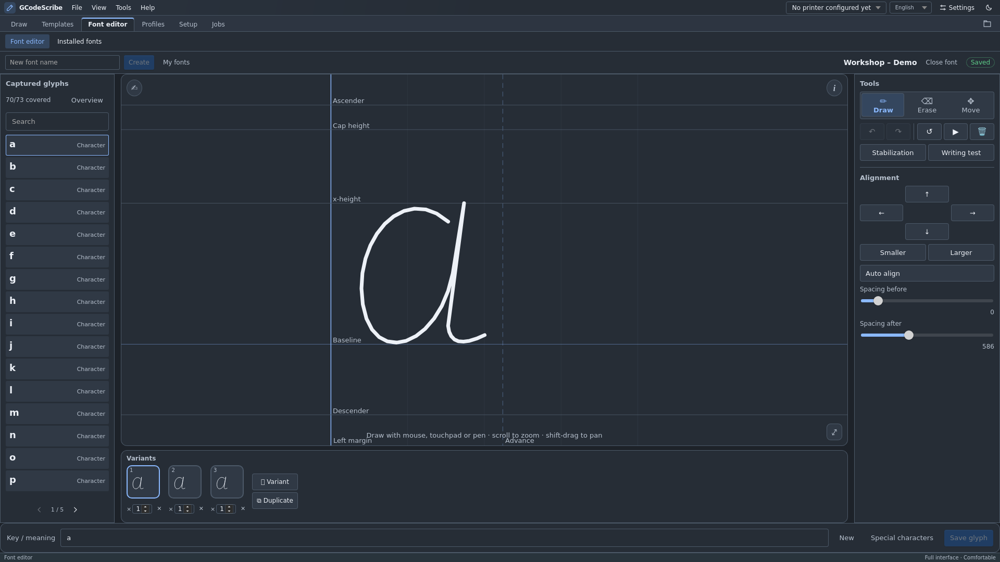
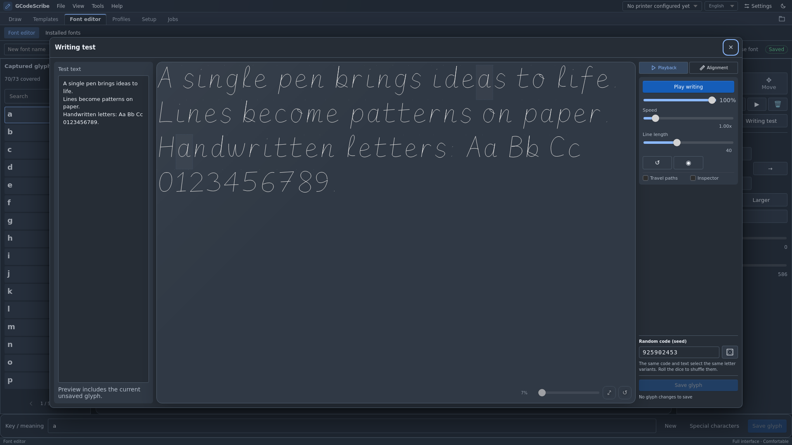
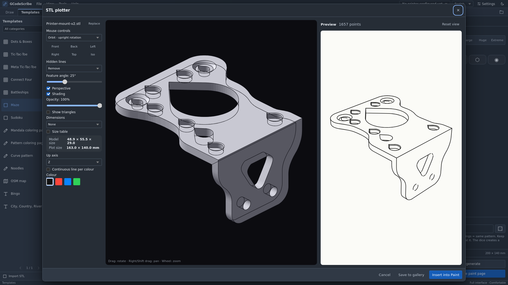
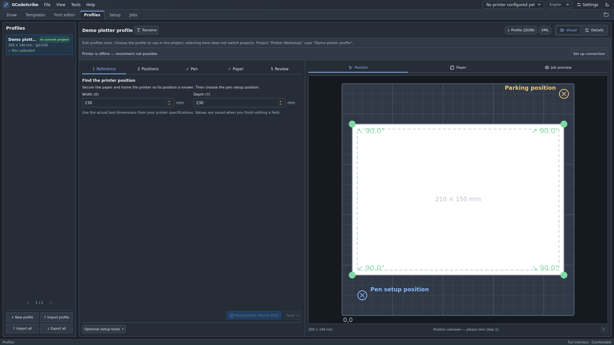

# GCodeScribe screenshot gallery

Every screenshot shows the English desktop interface in landscape format at **1920 × 1080**. Projects, drawings and the stroke font are original demo data. No private projects, accounts, printer addresses or people are shown. Click any image to open it at full resolution.

## Design

### Drawing editor · Ideas become lines

[](../media/screenshots/design-overview.png)

Combine objects on a single page. The project structure stays visible on the left while text, patterns and imported lines share the drawing area.

### Botanical line drawing

[](../media/screenshots/design-botanical.png)

A complete composition made from open pen paths and the Workshop demo font. The artwork does not depict any people.

### Imaginary city map

[](../media/screenshots/design-map.png)

This example shows how a denser line drawing fits on a page. The map is synthetic and does not represent a home address or any real location.

## Custom fonts

### Edit characters and variants

[](../media/screenshots/font-editor.png)

The visible font is a real, saved and editable `.gcsfont` document. Its characters and variants consist of individual pen strokes, rather than a screenshot or a filled text outline.

[Download the demo font](../media/examples/workshop-demo.gcsfont) · [About this example](../media/examples/README.md)

### Writing test

[](../media/screenshots/font-preview.png)

Preview multiple characters from the custom font together. The sample uses neutral English sentences and includes letters and digits.

## Prepare a plot

### Colour layers

[](../media/screenshots/color-layers.png)

Colours are assigned to individual line segments and saved with the page. Each colour can then become a separate plot job.

### Technical drawing from STL

[](../media/screenshots/stl-import.png)

This example uses the included v2 printer mount. All controls appear together on the left, with the model in the centre and its technical drawing on the right.

### Calibration profile

[](../media/screenshots/profile-calibration.png)

The paper, drawing bounds and special positions belong to the demo profile. No physical printer is moved to create this documentation image.

### G-code preview

[](../media/screenshots/gcode-preview.png)

Inspect drawing paths and travel moves before plotting. The large preview has independent controls for travel paths, the print bed and profile outlines.

## Templates

### Dots & Boxes

[](../media/screenshots/templates-grid.png)

Templates adapt their dimensions to the drawing area. Repeatable seeds and visible parameters let you create variations of the same design.

### Maze

[](../media/screenshots/templates-maze.png)

Add a generated drawing as a new page, then continue editing it in the designer.

## Media organisation and provenance

- `media/screenshots/`: current, reviewed app screenshots.
- `media/hardware/`: supplied assembly and plot photographs.
- `media/branding/`: supplied icon pack organised into web, PNG, SVG and desktop variants.
- `media/examples/`: importable demo stroke font.
- `media/models/`: current v2 print parts and CAD files; earlier designs are under `old/`.

The nine screenshots originally placed in the repository root have been replaced with corresponding new views. Unedited originals remain backed up locally and are excluded from Git and release archives. The drawing overview and G-code preview supplement those nine views. All eleven current screenshots use English UI labels and English artwork.

To create fresh demo data, run the following from the repository with its Python environment installed:

```sh
.venv/bin/python scripts/docs/create_demo.py \
  --data-dir /tmp/gcodescribe-docs-demo \
  --export-dir /tmp/gcodescribe-docs-export
```

Choose a new, empty directory each time. The fixture contains no configured printer. Use this data in a separate app session, select **English** in the language menu and capture the window at 1920 × 1080.
